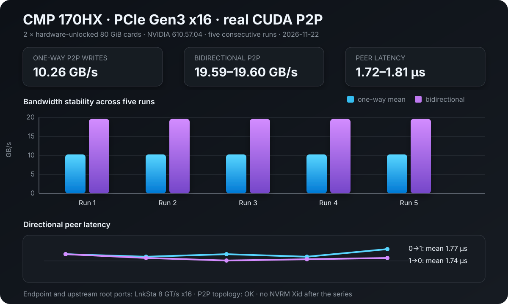
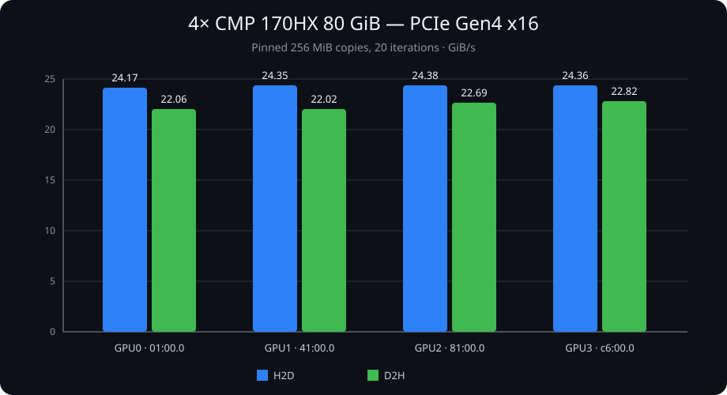
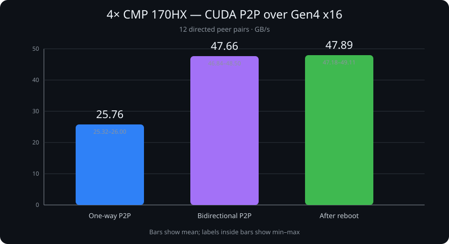

# CMP 170HX PCIe Gen3/Gen4: driver patches, fuse states, measurements, risks and P2P test plan

> 🇷🇺 **Buy modified CMP 170HX cards in Russia:** [Avito listing](https://www.avito.ru/voronezh/tovary_dlya_kompyutera/nvidia_cmp170_hx_x16_anlok_80_gb_110_sm_gen4_8492880790)
>
> 🛠️ **CMP 170HX modification service in Russia:** [Avito service listing](https://www.avito.ru/voronezh/nastolnye_kompyutery/nvidia_cmp_170hx_anlok_80_gig_gen4_sm_do_128_8437550194)

[Русская версия](PCIE-GEN4-2026-11-22.ru.md) · [P2P Issue #1](https://github.com/satspace-cpu/cmp170hx-linux-p2p/issues/1) · [80 GiB driver + P2P](CMP170HX-80GB-DRIVER-P2P.md)

> **Updated November 26, 2026.** The project server now runs **PCIe Gen4 x16 (16 GT/s)** on four hardware-unlocked 80 GiB CMP 170HX cards. Real pinned copies reached 24.17–24.38 GiB/s H2D and 22.02–22.82 GiB/s D2H. CUDA P2P is available across all 12 directed pairs and reaches 46.84–48.50 GB/s bidirectionally. After a reboot, the systemd service restored all four Gen4 x16 links and P2P remained functional.

## 1. Why this matters

PCIe Gen4 is no longer only a hypothetical CMP 170HX unlock. The community has published [driver patches and scripts](https://github.com/darkmaniac7/cmp170hx-10gb-pcie-gen4) for the 10 GB card (`10de:2082`, nvidia-open `615.71.09`), plus reports on hardware-unlocked 8 GB cards (`10de:20c2`).

| Device / configuration | Trained link | Measurement A | Measurement B | Evidence / limitation |
|---|---|---:|---:|---|
| 2× 10 GB `2082` | **Gen4 x4**, 16 GT/s | Pinned H2D **6.31–6.37 GB/s** | Pinned D2H **6.76 GB/s** | Public patch stack, authors' 30-minute soak; no AER/Xid in their runs |
| 8 GB `20c2`, card B | **Gen4 x8** | Pinned H2D **12.24 GB/s** | Pinned D2H **13.52 GB/s** | Lab note, short 60-second validation |
| 8 GB `20c2`, card H | **Gen4 x16** | Pinned H2D **24.3 GB/s** | Pinned D2H **24.1 GB/s** | Two runs on AMD EPYC; other attempts on that server experienced hard hangs |
| **Our 2× 80 GiB `20c2`** | **Gen3 x16**, 8 GT/s | P2P writes **10.26 GB/s** each way | Bidirectional **19.59–19.60 GB/s** | Five project-owned runs; 1.72–1.81 µs latency; no Xid |
| **Our 4× 80 GiB `20c2`** | **Gen4 x16**, 16 GT/s | Pinned H2D **24.17–24.38 GiB/s**, D2H **22.02–22.82 GiB/s** | P2P **25.32–26.00 GB/s** one-way, **46.84–48.50 GB/s** bidirectional | All 12 directed pairs; 2.20–2.30 µs; post-reboot 47.18–49.11 GB/s; no Xid/AER |

Sources for the first three rows: [10 GB experiment](https://cmp.wiki/wiki/PCIe_Gen4_on_the_10_GB_card) · [8 GB burned card experiment](https://cmp.wiki/wiki/PCIe_Gen4_on_a_burned_8_GB_card). The final two rows are our November 22 and November 26 measurements. Host-transfer H2D/D2H and GPU-to-GPU P2P are different paths and are reported separately.

**PCIe Gen4 is neither NVLink nor automatic CUDA P2P.** Faster physical PCIe links do not grant peer memory access. Our [Issue #1](https://github.com/satspace-cpu/cmp170hx-linux-p2p/issues/1) corrected a prior false-positive mailbox test: reported transfer rates looked realistic while the destination GPU memory remained unchanged. Every new peer result must validate data contents.

## 2. Link width, generation and P2P are separate

The stock CMP 170HX PCB lacks AC-coupling capacitors for PCIe lanes 4–15. The [x4→x16 hardware modification](PCIE-X16-HARDWARE-MOD.md) populates 24 missing 0402, 220 nF capacitors. It changes **width**, not PCIe generation. Gen3 and Gen4 additionally need compatible GPU policy/PHY init, root-port support and link training. CUDA/NCCL P2P is an independent driver/topology problem.

| Link | One-direction line-code payload ceiling* | Reported pinned-copy range |
|---|---:|---|
| Gen2 x4 | 2.00 GB/s | ~1.7 GB/s |
| Gen3 x4 | 3.94 GB/s | ~3.2–3.4 GB/s |
| Gen4 x4 | 7.88 GB/s | ~6.3–6.8 GB/s |
| Gen2 x16 | 8.00 GB/s | ~6.5 GB/s |
| Gen3 x16 | 15.75 GB/s | ~13 GB/s |
| Gen4 x16 | 31.51 GB/s | ~24 GB/s |

*Excludes TLP overhead. This is **not** peer-to-peer bandwidth, NCCL bandwidth or token generation throughput.*

`LnkCap`/`LnkCap2` advertise capabilities; **`LnkSta` on both the endpoint and its upstream root port** proves actual trained speed/width. Pair that with pinned H2D and D2H copies. Some runtime Gen4 experiments still show a maximum Gen3 in `nvidia-smi`, because GSP/RM caches the maximum reported at boot.

## 3. Public sources and tested driver base

- **Patches/scripts:** https://github.com/darkmaniac7/cmp170hx-10gb-pcie-gen4
- **8 GB VFI/BAR0 tooling:** https://github.com/darkmaniac7/cmp170hx-8gb-vfi-tools
- **Gen3 work:** https://github.com/lixiangwuxian/170hx_tips
- **Original cmpunlocker:** https://github.com/amoghmunikote/cmpunlocker
- **8 GB voltage-glitch/FF research:** https://cmp.wiki/wiki/Voltage-glitch_unlock_(GA100VFI)
- **Fuse analysis:** https://github.com/sayhellotojungle/cmp170hx-ffcalc

The 10 GB author's tested stack uses **NVIDIA open kernel modules `615.71.09`** with cmpunlocker **`2c7e2ecd7944e791fec040d2680036beb4a9327b`**. Its four patches are `pcie-gen2-scaffolding-only.patch`, `pcie-gen3-gsp.patch`, `pcie-gen3-fuse-override.patch` and `pcie-gen4-g4.patch`. Its tools are `set_pcie_speed.c`, `cmp-gen3.sh`, `cmp_gen4_e1.py` and `cmp-gen4.sh`.

**Not a drop-in patch for `610.57.04` or the 8 GB `20c2`.** The published E1 helper intentionally checks for 10 GB `2082`, and the GSP/fuse/PCIe policy must be reviewed before porting.

**Important November 22 fix:** use the E1 script from commit **`0a5882e` or later**. An older Python BAR0 write path could issue an unwanted zero store before writing the actual register value. The fix enforces **one aligned 32-bit MMIO store per register**. This removes one identified risk, not proof that all EPYC hangs are fixed.

## 4. Fuse overview and 8 GB vs 10 GB

| Fuse-sense / override field | Address | Meaning |
|---|---|---|
| `OPT_DISABLE_GEN3_SPEED` | `0x00820250` | Disable Gen3 |
| `OPT_PCIE_BOOT_GEN3_DIS` | `0x00820580` | Gen3 disabled at boot |
| `OPT_PCIE_BOOT_GEN23_DIS` | `0x0082057C` | Gen2/Gen3 boot disable (especially relevant on 8 GB) |
| `PCIE_MAGIC_BITS_D` | `0x00820520` | Bit 25 (`0x02000000`) is Gen4 disable |
| `DISABLE_SW_OVERRIDE_STATUS` | `0x00820084` | Availability/status of software fuse overrides |

**10 GB `2082`:** The tested lab cards had a prior RIR gate burn, followed by **volatile** driver software overrides. The Gen4-specific FF/OTP burn was not needed on those cards; runtime PHY initialization and retrain were repeated each boot.

**8 GB `20c2`:** The published x8/x16 results came from **already FF-burned hardware-unlocked cards**, not untouched stock 8 GB cards. The report describes `OPT_DISABLE_GEN3_SPEED=0`, `OPT_PCIE_BOOT_GEN3_DIS=0`, `OPT_PCIE_BOOT_GEN23_DIS=0` and `PCIE_MAGIC_BITS_D=0x14680000` (Gen4 disable bit cleared). This does **not** establish a software-only path for arbitrary `20c2` boards.

**Our two 80 GiB cards (read-only inventory):** `DSOV=1`, `GEN3_DIS=0`, `GEN23_DIS=0`, `BOOT_GEN3=0`, `MAGIC_D=0x14680000` on both devices. The decisive change compared with our earlier failed Gen3 attempts was `GEN23_DIS=0`. These values were verified before driver experiments; this document does not describe how to burn them.

Do not write OTP/FF/RIR fuses as an exploratory shortcut. First inventory each GPU and distinguish sensed physical state from effective software overrides. Persistent fuse changes are outside the safe scope of this guide.

## 5. Reproduced Gen3 path on our 80 GiB cards

The working project-owned setup is **NVIDIA 610.57.04** on Ubuntu 26.04.1, kernel `7.0.0-42-generic`, with two `10de:20c2` cards at `81:00.0` and `82:00.0`. Both endpoint and upstream root-port links finally report `LnkSta: Speed 8GT/s, Width x16`.

What actually happened:

1. We ported the current Gen3/Gen4 GSP patch from the server-19 research tree into a separate copy of the known-good 80 GiB + P2P source tree on server 44.
2. Source comparison exposed an older extra function in `kernel-open/nvidia/nv.c`: `nv_cmp170hx_retrain_gen2()`. It ran on the first device open and wrote Gen2 policy back into BAR0 and PCIe Link Control 2. This is why a direct retrain could briefly show Gen3, then `nvidia-smi` returned the card to Gen2.
3. We changed that path to Gen3: clear CYA_0 bits 2/3, set inverse `LINK_CONFIG_0.MAX_RATE=1`, write XVE `0x8872c=8`, request 8 GT/s on both endpoint and root port, then issue one root-port retrain.
4. The RM helper accepted Gen1 and Gen2 but returned **status `0x40`** for speed 3 even after the fuse state was open. It is therefore not part of the final working route.
5. An early retrain during `nv_start_device()` could still run before the link was ready and report `status=0x1102`. A small host-local oneshot service now initializes RM/GSP with `nvidia-smi -L`, waits two seconds, accepts an already-trained Gen3 link, or performs one late config-space retrain and verifies Gen3 x16. It never loops indefinitely.
6. After reboot, both GPUs and both CPU root ports report 8 GT/s x16; `nvidia-smi` reports generation 3; 80 GiB and P2P remain available.

Active module:

```text
/lib/modules/7.0.0-42-generic/updates/cmpunlocker/nvidia.ko
SHA256 3b8fb6a9ab12397b0ebf803c9939a1ae0269d807e48f3206bd3856b18021e754
```

Registry configuration used on this host:

```text
options nvidia NVreg_EnablePCIeGen3=1 NVreg_RegistryDwords="RmForceEnableGen2=1;RMPcieLinkSpeed=0x5;CmpGen3=1;CmpReconfig=1"
```

The final late retrain is equivalent to setting target speed 3 on the specific GPU and its upstream root port, then setting the root-port Retrain Link bit once. Do not copy our BDFs: resolve the parent bridge dynamically, and do not run this path on a stock card whose fuse state has not been verified.

### Reproduced Gen4 path on `610.57.04/20c2`

Server 19 uses a separate `20c2-hw80-gen3-gen4` profile based on NVIDIA Open Kernel Modules `610.57.04`. The active module is:

```text
/lib/modules/7.0.12-cmp170bar1test/updates/cmpunlocker/nvidia.ko
SHA256 7dc0a1164ca3efa7015c60385482e4e2bd9cd65e9d24bc46bbd164547a9f8b57
```

It contains the Gen3 GSP block ported to `10de:20c2`, `cmp_fuse_gen4` support, runtime E1 and a guarded single retrain. Existing 80 GiB HBM geometry, the P2P companion and BAR configuration were left unchanged. The tested cards were already hardware-prepared: `GEN3_DIS=0`, `GEN23_DIS=0`, `BOOT_GEN3_DIS=0`, and bit 25 of `PCIE_MAGIC_BITS_D` was clear (`MAGIC_D=0x14680000`).

The module configuration keeps the validated Gen3 boot path:

```text
options nvidia NVreg_EnablePCIeGen3=1 NVreg_RegistryDwords="RmForceEnableGen2=1;RMPcieLinkSpeed=0x5;CmpGen3=1;CmpReconfig=1"
```

We deliberately **did not enable `CmpGen4=1`**. As documented by the upstream driver project, the proven route applies E1 after a real Gen3 link is ready. For each card, once per boot:

```bash
BDF=0000:01:00.0  # example only; resolve the real BDF
sudo cmp-gen3-20c2 "$BDF"
sudo python3 -I /usr/local/sbin/cmp-gen4-e1-20c2 "$BDF" --apply
sudo cmp-gen4-20c2 "$BDF"
```

The sequence:

1. Trains Gen3 and verifies 8 GT/s at the endpoint and upstream root port.
2. Restores the A100 Gen4 PHY portion omitted by CMP VBIOS: `0x88CE4=0x14`, `0x88CE0[5:0]=6`, and the Gen4 fields in `CYA_0`, `PL_LINK_RATE`, `LINK_CONFIG_0`, `VSEC`, `PRIV_MISC_1` and internal `LnkCap`.
3. Sets target speed 4 on the endpoint and root port, then issues **one** retrain from the root port.
4. Accepts the transition only if both ends are Gen4, x16 is retained, PCI config space remains readable and no new uncorrectable AER appears.

After the manual validation, a `cmp170-gen4.service` oneshot was enabled. It waits for NVIDIA initialization, discovers `10de:20c2` cards dynamically and runs Gen3 → E1 → Gen4 exactly once per card. It never loops failed retrains. On the November 26 reboot it exited with `status=0/SUCCESS`; all four links returned at 16 GT/s x16, each framebuffer remained 81920 MiB, and bidirectional P2P measured 47.18–49.11 GB/s.

Ready-to-install boot files are provided as [`scripts/cmp170-gen4-all-20c2.sh`](../scripts/cmp170-gen4-all-20c2.sh) and [`systemd/cmp170-gen4.service`](../systemd/cmp170-gen4.service). Install them **only after every card has passed the manual sequence once**:

```bash
sudo install -m 0755 scripts/cmp170-gen4-all-20c2.sh /usr/local/sbin/cmp170-gen4-all-20c2
sudo install -m 0644 systemd/cmp170-gen4.service /etc/systemd/system/cmp170-gen4.service
sudo systemctl daemon-reload
sudo systemctl enable cmp170-gen4.service
```

`nvidia-smi` still reports Gen3. This is expected because RM cached the capability before the late retrain. Endpoint/root-port `LnkSta`, sysfs `current_link_speed`, and pinned copy bandwidth are the authoritative checks.

## 6. The AMD EPYC warning

On a dual-socket AMD EPYC lab server, **5 out of 15** E1 attempts caused a full host halt during the `LINK_CONFIG_0` operation; BMC power cycling was required. The researchers did not observe the same hangs on their Intel bench in that series. The root cause is **still under investigation**, even after the MMIO single-store fix. Do not test this on a production LLM server with active CUDA clients, and do not assume a software rollback can recover a wedged root complex. Out-of-band power control is strongly recommended.

## 7. Integration with this repository's P2P stacks

This repository already documents **two distinct configurations**:

- [Software-unlocked 64 GiB + Static BAR1 P2P](STATIC-BAR1-P2P.md): specific BAR1/resource/driver patches, with verified peer copies, SM remote reads/writes and NCCL correctness.
- [Hardware-unlocked 80 GiB + custom `610.57.04` driver and P2P companion](CMP170HX-80GB-DRIVER-P2P.md): this **must not** be combined with the 64 GiB Static BAR1 recipe. That mismatch caused a driver hang on our host.

For the new Gen4 work: preserve the known-good modules and exact patch hashes; use an isolated source tree; inspect `nv-pci.c`, `kernel_gsp_tu102.c`, `kernel_gsp.c`, `NVreg_RegistryDwords`, `cmp_fuse_bdf`, GSP timing and BAR1 compatibility. Prefer a carefully reviewed port into the existing `610.57.04` build; keep a separately tested `615.71.09` branch as a fallback. **Never change HBM geometry, P2P, ECC, clock settings and PCIe policy all at once.** Test **one GPU first**.

Gen4 can improve PCIe-bound traffic, but it will not automatically multiply CUDA P2P performance or vLLM Tensor Parallel throughput. Measure NCCL all-reduce and TP/PP prefill/decode separately under identical conditions.

## 8. Read-only baseline commands

```bash
date -Is
uname -a
modinfo -F version nvidia
nvidia-smi --query-gpu=index,pci.bus_id,memory.total,pci.link.gen.current,pci.link.width.current --format=csv
lspci -Dnn | grep -i '10de:20c2'
lspci -tv
sudo lspci -Dnnvv > pcie-before.txt
sudo journalctl -k -b --no-pager | grep -Ei 'NVRM|Xid|AER|PCIe.*error' > pcie-errors-before.txt
```

Record the real endpoint BDFs and their upstream root ports before attempting any change. For each card save `LnkCap`, `LnkCap2`, `LnkSta`, `LnkCtl2`, `LnkSta2`, driver hashes, modprobe options, P2P mode, HBM geometry and current Xid/AER baseline. GPU indices are not stable identifiers.

## 9. Acceptance gates

| Stage | PASS | STOP |
|---|---|---|
| Gen2 x16 baseline | No new Xid/AER, content-verified directed CUDA P2P and NCCL | HBM errors, wrong peer contents, hangs |
| Gen3 x16 | 8 GT/s on endpoint and root port; width retained; host copies and P2P reported separately; stable repeated runs | Width fallback, AER/Xid, peer-data mismatch |
| Gen4 x16 | 16 GT/s on both ends, equalization, ~24 GB/s pinned copies, ≥30-min soak | Host hang, width/speed fallback, AER/Xid |
| P2P after Gen4 | Every directed pair passes `cudaMemcpyPeer`, SM remote read/write and NCCL correctness | Any mismatch or NCCL hang |
| LLM workload | Same model/quant, context, MTP, cache, batching and NCCL settings; compare prefill and decode separately | Non-comparable configurations |

Do not accept an `LnkCap2` screenshot alone as proof. A Gen4-looking link can still copy at Gen3 speed.

## 10. Project-owned Gen3 x16 results

> This section preserves the original November 22 Gen3 baseline. The new four-GPU Gen4 result follows in the next section.



| Field | Project measurement |
|---|---|
| Date / host | 2026-11-22, HUANANZHI X10X99-16D, BIOS 5.11 (2023-10-24) |
| OS / kernel / CPU | Ubuntu 26.04.1 LTS, `7.0.0-42-generic`, 2× Intel Xeon E5-2697 v4 |
| GPUs | 2× CMP 170HX `10de:20c2`, 81920 MiB each; BDFs `81:00.0`, `82:00.0` |
| Driver / module | NVIDIA 610.57.04; `nvidia.ko` SHA256 `3b8fb6a…21e754` |
| Endpoint + root-port link | **8 GT/s x16 on all four ends** |
| P2P topology | `nvidia-smi topo -p2p r`: **OK** in both directions |
| One-way P2P writes | **10.26 GB/s** in both directions, all five runs |
| Bidirectional P2P | **19.59–19.60 GB/s** |
| GPU peer latency | **1.72–1.81 µs**; directional means 1.77 / 1.74 µs |
| Driver health after series | No NVRM Xid or `RmInitAdapter failed` |
| Gen4 | Not tested on this host; a separate four-GPU project host is documented below |

Five consecutive runs:

| Run | 0→1 one-way | 1→0 one-way | 0→1 bidirectional | 1→0 bidirectional | latency 0→1 | latency 1→0 |
|---:|---:|---:|---:|---:|---:|---:|
| 1 | 10.26 | 10.26 | 19.59 | 19.59 | 1.77 µs | 1.77 µs |
| 2 | 10.26 | 10.26 | 19.60 | 19.60 | 1.75 µs | 1.74 µs |
| 3 | 10.26 | 10.26 | 19.59 | 19.60 | 1.77 µs | 1.72 µs |
| 4 | 10.26 | 10.26 | 19.59 | 19.59 | 1.75 µs | 1.73 µs |
| 5 | 10.26 | 10.26 | 19.59 | 19.60 | 1.81 µs | 1.74 µs |

Units are GB/s for bandwidth. [Raw output and exact hardware identifiers](../results/gen3-80gb-p2p-2026-11-22.txt).

This establishes a stable short Gen3/P2P baseline and remains useful for comparison.

## 11. Project-owned Gen4 x16 results on 4× 80 GiB





| Field | Project result |
|---|---|
| Date / host | 2026-11-26, server 19, HUANANZHI X10X99-16D |
| OS / kernel | Ubuntu 26.04.1 LTS, `7.0.12-cmp170bar1test` |
| GPUs | 4× CMP 170HX `10de:20c2`, **81920 MiB each**; `01:00.0`, `41:00.0`, `81:00.0`, `c6:00.0` |
| Driver | NVIDIA `610.57.04`; `nvidia.ko` SHA256 `7dc0a116…f8b57` |
| Endpoint + root port | **16 GT/s x16** on all four cards; equalization complete |
| Pinned H2D | **24.17–24.38 GiB/s** |
| Pinned D2H | **22.02–22.82 GiB/s** |
| P2P connectivity | Full matrix of `1`: all 12 directed peer pairs are available |
| P2P one-way | **25.32–26.00 GB/s**, mean 25.76 GB/s |
| P2P bidirectional | **46.84–48.50 GB/s**, mean 47.66 GB/s |
| GPU peer latency | Typically **2.20–2.30 µs** between distinct GPUs |
| After reboot | All 4× Gen4 x16; P2P **47.18–49.11 GB/s**, mean 47.89 GB/s |
| Health | No new NVRM Xid, uncorrectable AER or PCIe Bus Error |

The host-transfer test used pinned 256 MiB buffers for 20 iterations. P2P was measured with NVIDIA CUDA Samples `p2pBandwidthLatencyTest`; it is a transport diagnostic, not an application-level LLM benchmark. Full output, CUDA device order, and matrices from both the initial run and the post-reboot run are in [`results/gen4-80gb-4gpu-2026-11-26.txt`](../results/gen4-80gb-4gpu-2026-11-26.txt).

This is not “Gen4 in name only”: 24+ GiB/s H2D is materially beyond practical Gen3 x16 throughput, and the boot service reproduces the same physical link and P2P after reboot. A long soak, NCCL AllReduce and controlled LLM throughput comparisons remain separate tests.

## 12. Sources and credits

- [darkmaniac7 / cmp170hx-10gb-pcie-gen4](https://github.com/darkmaniac7/cmp170hx-10gb-pcie-gen4)
- [darkmaniac7 / cmp170hx-8gb-vfi-tools](https://github.com/darkmaniac7/cmp170hx-8gb-vfi-tools)
- [CMP Wiki / 8 GB Gen4](https://cmp.wiki/wiki/PCIe_Gen4_on_a_burned_8_GB_card)
- [CMP Wiki / 10 GB Gen4](https://cmp.wiki/wiki/PCIe_Gen4_on_the_10_GB_card)
- [CMP Wiki / GA100VFI](https://cmp.wiki/wiki/Voltage-glitch_unlock_(GA100VFI))
- [lixiangwuxian / 170hx_tips](https://github.com/lixiangwuxian/170hx_tips)
- [amoghmunikote / cmpunlocker](https://github.com/amoghmunikote/cmpunlocker)
- [sayhellotojungle / cmp170hx-ffcalc](https://github.com/sayhellotojungle/cmp170hx-ffcalc)
- [Our verified P2P / corrected false positive](https://github.com/satspace-cpu/cmp170hx-linux-p2p/issues/1)

Credit to CMPGlitch, lxwx/170hx_tips, darkmaniac7 and the wider CMP 170HX community. External numbers are attributed, **never represented as this project's own measurements**.
