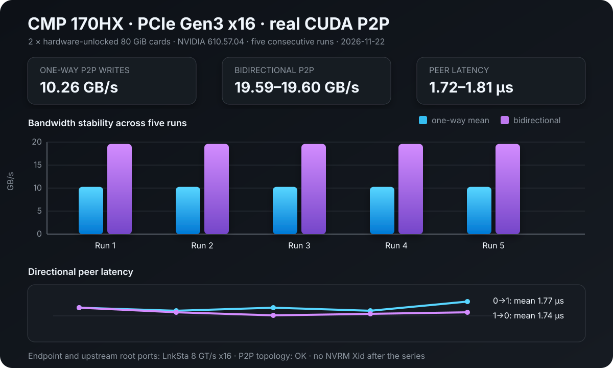
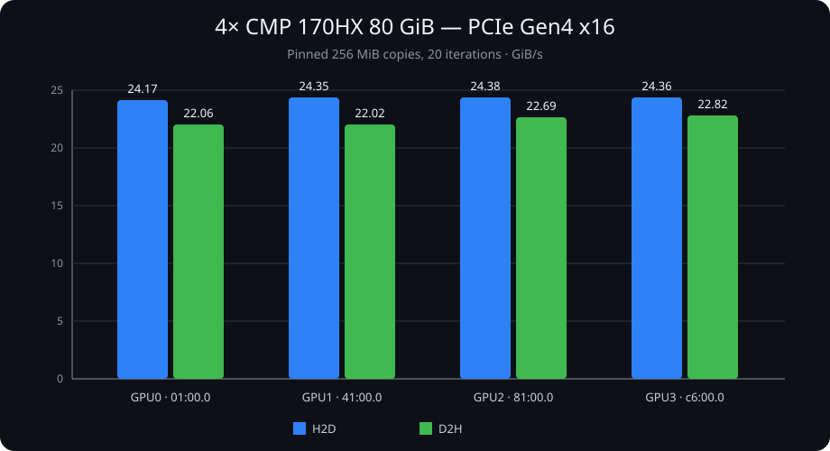
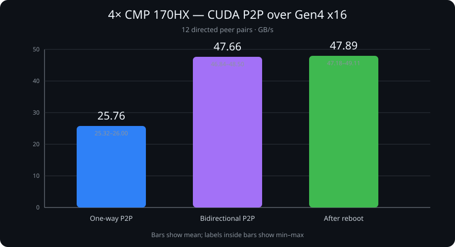

# CMP 170HX: PCIe Gen3/Gen4 — патчи драйвера, фьюзы, подтверждения, риски и план испытаний P2P

> 🇷🇺 **Купить в России переделанные карты CMP 170HX:** [объявление на Avito](https://www.avito.ru/voronezh/tovary_dlya_kompyutera/nvidia_cmp170_hx_x16_anlok_80_gb_110_sm_gen4_8492880790)
>
> 🛠️ **Переделать CMP 170HX в России:** [услуга на Avito](https://www.avito.ru/voronezh/nastolnye_kompyutery/nvidia_cmp_170hx_anlok_80_gig_gen4_sm_do_128_8437550194)

[English version](PCIE-GEN4-2026-11-22.md) · [P2P Issue #1](https://github.com/satspace-cpu/cmp170hx-linux-p2p/issues/1) · [Драйвер 80 ГиБ + P2P](CMP170HX-80GB-DRIVER-P2P.ru.md)

> **Обновлено 26 ноября 2026 года.** На сервере проекта воспроизведён **PCIe Gen4 x16 (16 GT/s)** сразу на четырёх аппаратно разблокированных CMP 170HX по 80 ГиБ. Реальные pinned-копирования достигли 24.17–24.38 GiB/s H2D и 22.02–22.82 GiB/s D2H; CUDA P2P доступен во всех 12 направленных парах и даёт 46.84–48.50 GB/s двунаправленно. После перезагрузки systemd-служба снова подняла все четыре линка в Gen4 x16, P2P сохранился.

## 1. Что изменилось

Gen4 на NVIDIA CMP 170HX больше не является только гипотезой. Появился [публичный набор патчей и скриптов](https://github.com/darkmaniac7/cmp170hx-10gb-pcie-gen4) для 10-гигабайтной карты `10de:2082` под `nvidia-open 615.71.09`, а также опубликованы результаты на аппаратно разблокированных 8-гигабайтных `10de:20c2`:

| Вариант | PCIe | Измерение A | Измерение B | Источник / ограничения |
|---|---|---:|---:|---|
| 10 GB `2082`, две карты | **Gen4 x4**, 16 GT/s | Pinned H2D 6.31–6.37 GB/s | Pinned D2H 6.76 GB/s | Авторский 30-минутный тест, нулевые AER/Xid в его отчёте |
| 8 GB `20c2`, карта B | **Gen4 x8** | Pinned H2D 12.24 GB/s | Pinned D2H 13.52 GB/s | Один лабораторный стенд, короткий тест |
| 8 GB `20c2`, карта H | **Gen4 x16** | Pinned H2D **24.3 GB/s** | Pinned D2H **24.1 GB/s** | На AMD EPYC, воспроизведено дважды; были опасные зависания в других попытках |
| Наши 2× 80 ГиБ `20c2` | **Gen3 x16**, 8 GT/s | P2P write **10.26 GB/s** в каждую сторону | Двунаправленно **19.59–19.60 GB/s** | Пять собственных прогонов; задержка 1.72–1.81 мкс; без Xid |
| **Наши 4× 80 ГиБ `20c2`** | **Gen4 x16**, 16 GT/s | Pinned H2D **24.17–24.38 GiB/s**, D2H **22.02–22.82 GiB/s** | P2P **25.32–26.00 GB/s** one-way, **46.84–48.50 GB/s** bidirectional | Все 12 направленных пар; 2.20–2.30 мкс; после reboot 47.18–49.11 GB/s; без Xid/AER |

Источники первых трёх строк: [10 GB Gen4](https://cmp.wiki/wiki/PCIe_Gen4_on_the_10_GB_card), [8 GB burned Gen4](https://cmp.wiki/wiki/PCIe_Gen4_on_a_burned_8_GB_card). Последние две строки — наши собственные тесты от 22 и 26 ноября. Host-transfer H2D/D2H и GPU→GPU P2P — разные тракты; они приведены раздельно.

**Gen4 — не NVLink и не автоматическое включение P2P.** PCIe увеличивает возможности шины; GPU→GPU P2P требует собственных драйверных разрешений и обязательной проверки корректности переданных данных. Наш [Issue #1](https://github.com/satspace-cpu/cmp170hx-linux-p2p/issues/1) объясняет, как mailbox-путь ранее показывал убедительные «скорости», не изменяя память удалённого GPU.

## 2. PCIe ширина, поколение и пропускная способность — три разных вопроса

- **Ширина x4/x8/x16:** на штатной CMP 170HX для линий 4–15 не установлены AC-coupling конденсаторы. [Переделка x4→x16](PCIE-X16-HARDWARE-MOD.ru.md) — установка 24 × 0402, 220 нФ — восстанавливает физические линии, но не Gen4.
- **Скорость:** Gen1 = 2.5 GT/s, Gen2 = 5 GT/s, Gen3 = 8 GT/s, Gen4 = 16 GT/s. `LnkCap2` показывает возможность, а `LnkSta` — реально обученный линк. Проверять и GPU, и upstream root port.
- **P2P:** BAR1/driver/GSP/ACS/IOMMU/NCCL влияют на доступность копирования между GPU отдельно от линка.

| Линк | Теоретическая полоса в одну сторону* | Реальная pinned H2D/D2H из опубликованных результатов |
|---|---:|---|
| Gen2 x4 | 2.00 GB/s | ≈1.7 GB/s |
| Gen3 x4 | 3.94 GB/s | ≈3.2–3.4 GB/s |
| Gen4 x4 | 7.88 GB/s | ≈6.3–6.8 GB/s |
| Gen2 x16 | 8.00 GB/s | ≈6.5 GB/s |
| Gen3 x16 | 15.75 GB/s | ≈13 GB/s |
| Gen4 x16 | 31.51 GB/s | ≈24 GB/s |

*До накладных расходов PCIe TLP; это не скорость NCCL и не гарантия ускорения vLLM Tensor Parallel. Сравниваются одинаковые направления H2D/D2H, а не суммарный двунаправленный трафик.*

## 3. Публичный код и фактические предпосылки

**Главный репозиторий:** https://github.com/darkmaniac7/cmp170hx-10gb-pcie-gen4

Его состав:

- `patches/pcie-gen2-scaffolding-only.patch` — сохранение Booter/privilege-основы для старших режимов.
- `patches/pcie-gen3-gsp.patch` — инициализация Gen3 после GSP.
- `patches/pcie-gen3-fuse-override.patch` — software override и селектор карты `cmp_fuse_bdf`.
- `patches/pcie-gen4-g4.patch` — поддержка Gen4 и переключатели, в том числе `cmp_fuse_gen4`.
- `tools/set_pcie_speed.c`, `tools/cmp-gen3.sh` — последовательность перехода к Gen3.
- `tools/cmp_gen4_e1.py` — проверка и runtime-инициализация PHY (E1).
- `tools/cmp-gen4.sh` — однократное PCIe retrain через конфигурационное пространство.

Проверенная база авторов: **NVIDIA 615.71.09 + cmpunlocker commit `2c7e2ecd7944e791fec040d2680036beb4a9327b`**. Авторский скрипт E1 рассчитан на `2082` и **не является готовым скриптом для `20c2`**. Подмена PCI ID без анализа отличий GSP/DevInit и фьюзов — плохая идея.

Дополнительные репозитории:

- [8 GB VFI tools + исправление BAR0 store](https://github.com/darkmaniac7/cmp170hx-8gb-vfi-tools)
- [170hx_tips — исследование Gen3](https://github.com/lixiangwuxian/170hx_tips)
- [Оригинальный cmpunlocker](https://github.com/amoghmunikote/cmpunlocker)
- [CMP Wiki — 8 GB VFI/FF](https://cmp.wiki/wiki/Voltage-glitch_unlock_(GA100VFI))
- [FFCalc — разбор фьюзов](https://github.com/sayhellotojungle/cmp170hx-ffcalc)

**Критическое обновление 22.11.2026:** использовать `cmp_gen4_e1.py` не старее исправления **`0a5882e`**: предыдущая реализация записи через `struct.pack_into` могла фактически записывать в MMIO сначала ноль, затем целевое значение. Это особенно опасно для `LINK_CONFIG_0`. Исправленный вариант выполняет **одну выровненную 32-битную запись**. Сам факт исправления **не доказывает устранение всех зависаний** на AMD EPYC.

## 4. Фьюзы и различие 8 GB / 10 GB

| Регистр / поле | BAR0 адрес | Роль |
|---|---|---|
| `OPT_DISABLE_GEN3_SPEED` | `0x00820250` | Gen3 disable |
| `OPT_PCIE_BOOT_GEN3_DIS` | `0x00820580` | Boot Gen3 disable |
| `OPT_PCIE_BOOT_GEN23_DIS` | `0x0082057C` | Boot Gen2/Gen3 disable; важен для 8 GB |
| `PCIE_MAGIC_BITS_D` | `0x00820520` | В том числе **bit 25** (`0x02000000`) — Gen4 disable |
| `DISABLE_SW_OVERRIDE_STATUS` | `0x00820084` | Статус разрешения software fuse override |

**10 GB `2082`.** В опубликованной рабочей конфигурации был ранее сделан RIR gate burn, затем драйвер временно очищал необходимые запреты через software override. Runtime E1 и retrain повторяются после перезагрузки. Дополнительная запись именно Gen4 FF/OTP не потребовалась для этого стенда.

**8 GB `20c2`.** Опубликованные Gen4 x8/x16 данные получены на картах, которые **уже имели аппаратные FF-записи после voltage glitch**. В отчёте `OPT_DISABLE_GEN3_SPEED`, `OPT_PCIE_BOOT_GEN3_DIS` и `OPT_PCIE_BOOT_GEN23_DIS` равны нулю, `PCIE_MAGIC_BITS_D=0x14680000` (bit 25 очищен). Для полностью стоковой 8 GB карты такой результат **не доказан**.

**Наши две карты по 80 ГиБ (read-only inventory):** на обеих подтверждено `DSOV=1`, `GEN3_DIS=0`, `GEN23_DIS=0`, `BOOT_GEN3=0`, `MAGIC_D=0x14680000`. Ключевое отличие от предыдущих неудачных попыток — теперь `GEN23_DIS=0`. Значения считаны до экспериментов с драйвером; процедура необратимой записи фьюзов здесь не публикуется.

**Рекомендация:** сперва снять read-only дампы и определить фактическое эффективное состояние на **каждой** карте. OTP, FF и RIR — необратимые изменения; эта статья **не является процедурой их программирования**.

## 5. Воспроизведённый путь Gen3 на наших 80-ГиБ картах

Рабочий стенд: **NVIDIA 610.57.04**, Ubuntu 26.04.1, ядро `7.0.0-42-generic`, две карты `10de:20c2` в `81:00.0` и `82:00.0`. В финале и GPU, и их CPU root ports показывают `LnkSta: Speed 8GT/s, Width x16`.

Что было сделано и что оказалось важным:

1. Актуальный Gen3/Gen4 GSP-патч из исследовательского дерева сервера 19 перенесён в отдельную копию уже рабочего исходника 80 ГиБ + P2P на сервере 44.
2. Сравнение исходников нашло старую дополнительную функцию `nv_cmp170hx_retrain_gen2()` в `kernel-open/nvidia/nv.c`. При первом открытии устройства она снова записывала Gen2 в BAR0 и Link Control 2. Поэтому прямой retrain на короткое время давал Gen3, а запуск `nvidia-smi` возвращал Gen2.
3. Этот путь переделан под Gen3: очистка битов 2/3 CYA_0, инверсное `LINK_CONFIG_0.MAX_RATE=1`, запись XVE `0x8872c=8`, target 8 GT/s для GPU и root port и один retrain со стороны root port.
4. RM-утилита принимала Gen1 и Gen2, но для speed 3 возвращала **status `0x40`** даже после открытия фьюза. В финальную схему она не вошла.
5. Ранний retrain внутри `nv_start_device()` иногда выполнялся до готовности линка и видел `status=0x1102`. Поэтому локальная oneshot-служба сначала инициализирует RM/GSP командой `nvidia-smi -L`, ждёт две секунды, принимает уже поднятый Gen3 либо выполняет один поздний config-space retrain и проверяет Gen3 x16. Бесконечных повторов нет.
6. После перезагрузки обе GPU и оба root port работают 8 GT/s x16; `nvidia-smi` показывает generation 3; 80 ГиБ и P2P сохранены.

Активный модуль:

```text
/lib/modules/7.0.0-42-generic/updates/cmpunlocker/nvidia.ko
SHA256 3b8fb6a9ab12397b0ebf803c9939a1ae0269d807e48f3206bd3856b18021e754
```

Параметры данного стенда:

```text
options nvidia NVreg_EnablePCIeGen3=1 NVreg_RegistryDwords="RmForceEnableGen2=1;RMPcieLinkSpeed=0x5;CmpGen3=1;CmpReconfig=1"
```

Поздний retrain выставляет target speed 3 на конкретной GPU и её upstream root port, затем один раз устанавливает Retrain Link у root port. Адреса слотов нашего сервера копировать нельзя: parent bridge нужно определять динамически. Этот путь нельзя запускать на стоковой карте без предварительной проверки фьюзов.

### Воспроизведённый путь Gen4 на `610.57.04/20c2`

На сервере 19 использован уже подготовленный отдельный профиль `20c2-hw80-gen3-gen4` на базе NVIDIA Open Kernel Modules `610.57.04`. Активный модуль:

```text
/lib/modules/7.0.12-cmp170bar1test/updates/cmpunlocker/nvidia.ko
SHA256 7dc0a1164ca3efa7015c60385482e4e2bd9cd65e9d24bc46bbd164547a9f8b57
```

Он содержит портированные на `10de:20c2` Gen3 GSP-блок, поддержку `cmp_fuse_gen4`, runtime E1 и безопасный однократный retrain. Существующие 80-ГиБ HBM, P2P companion и BAR-конфигурация не менялись. На протестированных картах аппаратная подготовка уже была завершена: `GEN3_DIS=0`, `GEN23_DIS=0`, `BOOT_GEN3_DIS=0`, а bit 25 `PCIE_MAGIC_BITS_D` очищен (`MAGIC_D=0x14680000`).

Параметры модуля оставлены на проверенном Gen3-старте:

```text
options nvidia NVreg_EnablePCIeGen3=1 NVreg_RegistryDwords="RmForceEnableGen2=1;RMPcieLinkSpeed=0x5;CmpGen3=1;CmpReconfig=1"
```

Мы **не включали `CmpGen4=1`**. Как и в upstream-описании драйвера, подтверждённый путь выполняет E1 после готового Gen3-линка. Для каждой карты, по одной попытке за загрузку:

```bash
BDF=0000:01:00.0  # пример; определите реальный BDF своей карты
sudo cmp-gen3-20c2 "$BDF"
sudo python3 -I /usr/local/sbin/cmp-gen4-e1-20c2 "$BDF" --apply
sudo cmp-gen4-20c2 "$BDF"
```

Последовательность делает следующее:

1. Поднимает Gen3 и проверяет 8 GT/s на GPU и upstream root port.
2. E1 восстанавливает пропущенную CMP VBIOS часть A100 Gen4 PHY: `0x88CE4=0x14`, поле `0x88CE0[5:0]=6`, Gen4-поля `CYA_0`, `PL_LINK_RATE`, `LINK_CONFIG_0`, `VSEC`, `PRIV_MISC_1` и внутренний `LnkCap`.
3. Выставляет target speed 4 на endpoint и root port и запускает **ровно один** retrain со стороны root port.
4. Принимает результат только при Gen4 на обоих концах, сохранённой x16, отсутствии новых uncorrectable AER и читаемом PCI config space.

После проверки вручную добавлена oneshot-служба `cmp170-gen4.service`. Она ждёт инициализации NVIDIA, динамически находит карты `10de:20c2` и один раз выполняет Gen3 → E1 → Gen4 для каждой карты. Повторных циклов при ошибке нет. После перезагрузки 26.11.2026 служба завершилась `status=0/SUCCESS`, все четыре линка вернулись в 16 GT/s x16, framebuffer остался 81920 MiB, а двунаправленный P2P составил 47.18–49.11 GB/s.

Готовые файлы автозапуска: [`scripts/cmp170-gen4-all-20c2.sh`](../scripts/cmp170-gen4-all-20c2.sh) и [`systemd/cmp170-gen4.service`](../systemd/cmp170-gen4.service). Они устанавливаются **только после успешного ручного прогона каждой карты**:

```bash
sudo install -m 0755 scripts/cmp170-gen4-all-20c2.sh /usr/local/sbin/cmp170-gen4-all-20c2
sudo install -m 0644 systemd/cmp170-gen4.service /etc/systemd/system/cmp170-gen4.service
sudo systemctl daemon-reload
sudo systemctl enable cmp170-gen4.service
```

`nvidia-smi` продолжает показывать Gen3 — это ожидаемо: RM кэширует возможность линка до позднего retrain. Фактический режим подтверждают endpoint/root-port `LnkSta`, `current_link_speed` и реальные pinned-копирования.

## 6. Главные риски (особенно AMD EPYC)

На двухсокетном EPYC-стенде лаборатории в **5/15 попыток** E1 запись 7 в `LINK_CONFIG_0` привела к полному зависанию хоста (sync flood), восстановление потребовало BMC power cycle. На Intel-стенде в той серии зависаний не наблюдалось. Исследование причин открыто. На уже работающем Gen4 попытка unbind/rebind драйвера дала **Xid 140**, `BAR0=0xbadf1020` и `probe=-5`.

**Не запускать E1 и retrain на сервере с активным CUDA/vLLM, не автоматизировать повторные попытки, не менять несколько GPU одновременно.** Даже доступный BMC не гарантирует сохранность данных. Не запускать старые копии скриптов до исправления single-store. Не смешивать отладку Gen4 с экспериментами HBM, ECC, BAR1 или увеличением SM.

## 7. Как это совмещается с нашим P2P

У репозитория есть **два отдельных проверенных профиля**, которые нельзя смешивать:

- **Обычная 8 GB → 64 GiB software unlock:** [Static BAR1 P2P](STATIC-BAR1-P2P.ru.md). Тут есть специфические патчи BAR1/bridge resource allocation. В [Issue #1](https://github.com/satspace-cpu/cmp170hx-linux-p2p/issues/1) проверены реальный CUDA peer copy, SM remote read/write и NCCL, а ложный mailbox-результат отозван.
- **8 GB → 80 GiB hardware unlock:** [Специальный драйвер `610.57.04` и P2P companion](CMP170HX-80GB-DRIVER-P2P.ru.md). **Не включать 64 GiB Static BAR1 для 80 GiB framebuffer**: на нашем стенде такая комбинация приводила к зависанию драйвера.

Для Gen4 работать **в отдельном дереве исходников**, переносить изменения минимальными патчами; сохранять SEC2 Booter, HBM layout, WPR/PLM, P2P, `170tune` и нынешние параметры. Основной вариант — портирование в наш `610.57.04`, резервный — отдельная проверка `615.71.09` со всеми нашими функциями. Проверять `nv-pci.c`, `kernel_gsp_tu102.c`, `kernel_gsp.c`, `NVreg_RegistryDwords`, селектор `cmp_fuse_bdf`, GSP timing, root-port capabilities и BAR1.

**Gen4 может заметно увеличить пропускную способность при PCIe-ограничениях, но рост H2D/D2H сам по себе не гарантирует прирост GPU→GPU или токенов/с.** TP зависит от NCCL и all-reduce, PP — от межстадийных передач, prefill/decode и batching ведут себя по-разному.

## 8. Что можно собрать сейчас без изменения оборудования

```bash
# Только чтение; выполняйте на своем Linux-хосте.
date -Is
uname -a
modinfo -F version nvidia
nvidia-smi --query-gpu=index,pci.bus_id,memory.total,pci.link.gen.current,pci.link.width.current --format=csv
lspci -Dnn | grep -i '10de:20c2'
lspci -tv
sudo lspci -Dnnvv > pcie-before.txt
sudo journalctl -k -b --no-pager | grep -Ei 'NVRM|Xid|AER|PCIe.*error' > pcie-errors-before.txt
```

Для **каждой** GPU и её CPU root port сохранить `LnkCap`, `LnkCap2`, `LnkSta`, `LnkCtl2`, `LnkSta2`, фактическую ширину и скорость. BDF могут меняться после перестановки карты; `GPU index` не равен постоянному физическому слоту. Отдельно сохранить текущие драйверные модули, SHA, модульные опции и исходники **до** изменений.

## 9. Порядок испытаний и критерии зачёта

| Этап | PASS | STOP |
|---|---|---|
| Gen2 x16 baseline | Чистые логи, корректные pinned H2D/D2H, CUDA P2P content-check, NCCL correctness | Xid, AER, ошибки HBM/peer data |
| Gen3 x16 | Реальные `LnkSta=8GT/s` у GPU и root port; ширина сохранена; H2D/D2H и P2P указаны раздельно; повторяемые тесты | Линк падает до x8/x4, Xid/AER или ошибка peer data |
| Gen4 x16 | Реальные `LnkSta=16GT/s` у обоих концов; equalization; ориентир ≈24 GB/s; ≥30 минут soak | Host halt, Xid, AER, деградация скорости/ширины |
| CUDA P2P | Все directed пары проходят `cudaMemcpyPeer`, SM read/write **с проверкой содержимого** | Хоть одно расхождение, NCCL hang |
| vLLM / llama.cpp | Одинаковые модель, квант, context, cache, MTP, NCCL, batch; отдельные prefill и decode | Сравнение изменённых условий |

**Замечание:** `nvidia-smi` после runtime retrain может всё ещё показывать Gen3 из-за кэша RM. Нужны `LnkSta` с обоих концов, sysfs, копирования и логи, а не один скриншот `LnkCap2`.

## 10. Наши собственные результаты Gen3 x16

> Этот раздел сохраняет исходный Gen3 baseline от 22.11.2026. Новый четырёхкарточный Gen4-результат приведён следующим разделом.



| Параметр | Наш результат |
|---|---|
| Дата / сервер | 22.11.2026, HUANANZHI X10X99-16D, BIOS 5.11 от 24.10.2023 |
| ОС / ядро / CPU | Ubuntu 26.04.1 LTS, `7.0.0-42-generic`, 2× Intel Xeon E5-2697 v4 |
| GPU | 2× CMP 170HX `10de:20c2`, по 81920 MiB; BDF `81:00.0`, `82:00.0` |
| Драйвер / модуль | NVIDIA 610.57.04; SHA256 `nvidia.ko`: `3b8fb6a…21e754` |
| GPU + root-port link | **8 GT/s x16 на всех четырёх концах** |
| P2P topology | `nvidia-smi topo -p2p r`: **OK** в обе стороны |
| Односторонний P2P write | **10.26 GB/s** в обе стороны во всех пяти прогонах |
| Двунаправленный P2P | **19.59–19.60 GB/s** |
| GPU peer latency | **1.72–1.81 мкс**; средние по направлениям 1.77 / 1.74 мкс |
| Состояние драйвера после серии | Нет NVRM Xid и `RmInitAdapter failed` |
| Gen4 | На этом стенде не тестировался; отдельный четырёхкарточный стенд приведён ниже |

Пять последовательных прогонов:

| Прогон | 0→1 one-way | 1→0 one-way | 0→1 bidirectional | 1→0 bidirectional | latency 0→1 | latency 1→0 |
|---:|---:|---:|---:|---:|---:|---:|
| 1 | 10.26 | 10.26 | 19.59 | 19.59 | 1.77 мкс | 1.77 мкс |
| 2 | 10.26 | 10.26 | 19.60 | 19.60 | 1.75 мкс | 1.74 мкс |
| 3 | 10.26 | 10.26 | 19.59 | 19.60 | 1.77 мкс | 1.72 мкс |
| 4 | 10.26 | 10.26 | 19.59 | 19.59 | 1.75 мкс | 1.73 мкс |
| 5 | 10.26 | 10.26 | 19.59 | 19.60 | 1.81 мкс | 1.74 мкс |

Для полосы единицы — GB/s. [Полный исходный вывод и идентификаторы оборудования](../results/gen3-80gb-p2p-2026-11-22.txt).

Это подтверждает короткую стабильную серию Gen3/P2P и остаётся полезным baseline для сравнения.

## 11. Наши собственные результаты Gen4 x16 на 4× 80 ГиБ





| Параметр | Результат проекта |
|---|---|
| Дата / сервер | 26.11.2026, сервер 19, HUANANZHI X10X99-16D |
| ОС / ядро | Ubuntu 26.04.1 LTS, `7.0.12-cmp170bar1test` |
| GPU | 4× CMP 170HX `10de:20c2`, по **81920 MiB**; `01:00.0`, `41:00.0`, `81:00.0`, `c6:00.0` |
| Драйвер | NVIDIA `610.57.04`; `nvidia.ko` SHA256 `7dc0a116…f8b57` |
| Endpoint + root port | **16 GT/s x16** на всех четырёх картах; equalization complete |
| Pinned H2D | **24.17–24.38 GiB/s** |
| Pinned D2H | **22.02–22.82 GiB/s** |
| P2P connectivity | Полная матрица `1`: все 12 направленных пар доступны |
| P2P one-way | **25.32–26.00 GB/s**, среднее 25.76 GB/s |
| P2P bidirectional | **46.84–48.50 GB/s**, среднее 47.66 GB/s |
| GPU peer latency | Обычно **2.20–2.30 мкс** между разными GPU |
| После перезагрузки | Все 4× Gen4 x16; P2P **47.18–49.11 GB/s**, среднее 47.89 GB/s |
| Здоровье | Новых NVRM Xid, uncorrectable AER и PCIe Bus Error не обнаружено |

Host-transfer тест использовал pinned-буферы 256 MiB и 20 итераций. P2P измерен NVIDIA CUDA Samples `p2pBandwidthLatencyTest`; это транспортная диагностика, а не прикладной LLM-бенчмарк. Полный вывод, порядок CUDA-устройств и обе матрицы после первого запуска и перезагрузки: [`results/gen4-80gb-4gpu-2026-11-26.txt`](../results/gen4-80gb-4gpu-2026-11-26.txt).

Результат подтверждает, что это не «Gen4 только в названии»: 24+ GiB/s H2D существенно выше практического потолка Gen3 x16, а после перезагрузки служба воспроизводит тот же физический линк и P2P. Длительный soak, NCCL AllReduce и сравнение скорости конкретных LLM остаются отдельными тестами.

## 12. Источники и признание авторства

- [darkmaniac7: Gen3/Gen4 patch set (10 GB)](https://github.com/darkmaniac7/cmp170hx-10gb-pcie-gen4)
- [darkmaniac7: 8 GB VFI/BAR0 tools](https://github.com/darkmaniac7/cmp170hx-8gb-vfi-tools)
- [CMP Wiki: Gen4 on a burned 8 GB card](https://cmp.wiki/wiki/PCIe_Gen4_on_a_burned_8_GB_card)
- [CMP Wiki: Gen4 on the 10 GB card](https://cmp.wiki/wiki/PCIe_Gen4_on_the_10_GB_card)
- [CMP Wiki: GA100VFI and PCIe fuses](https://cmp.wiki/wiki/Voltage-glitch_unlock_(GA100VFI))
- [lixiangwuxian / 170hx_tips](https://github.com/lixiangwuxian/170hx_tips)
- [amoghmunikote / cmpunlocker](https://github.com/amoghmunikote/cmpunlocker)
- [sayhellotojungle / cmp170hx-ffcalc](https://github.com/sayhellotojungle/cmp170hx-ffcalc)
- [Наш 80 GiB / P2P отчёт](CMP170HX-80GB-DRIVER-P2P.ru.md)
- [Наш Issue #1: подтверждённый P2P и исправление false positive](https://github.com/satspace-cpu/cmp170hx-linux-p2p/issues/1)

Благодарность CMPGlitch, lxwx/170hx_tips, darkmaniac7 и сообществу CMP 170HX за открытые исследования. Числа третьих сторон приведены с указанием источника, **не выданы за собственные тесты проекта**.
